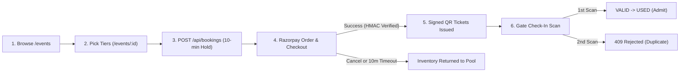

# ReserveX — Plain-English Explainer & Demo Walkthrough Guide

This guide helps you **understand and explain every part of ReserveX** clearly — whether you are walking through the app in a live demo, code review, or technical interview.

---

## 1. ReserveX in 60 Seconds

ReserveX is a **full-stack event ticketing platform** with two connected experiences sharing one database and API:

1. **Public Customer Storefront** (`/`, `/events`, `/events/:id`, `/checkout/:bookingId`, `/my-tickets`, `/my-bookings`)
   - Discover live concerts, festivals, comedy, sports, workshops, and arts events.
   - Reserve seats with a **10-minute concurrency-safe countdown hold**.
   - Pay via **Razorpay Checkout** (test mode) and receive **signed single-use QR entry passes**.
2. **Multi-Tenant Organizer Studio** (`/organizer/*`)
   - Create organizations, invite staff/co-owners by email, create & publish events, set INR ticket tiers, view sales analytics charts, monitor bookings, and scan QR passes at the venue gate.

---

## 2. End-to-End Ticket Lifecycle (How Everything Connects)

---

## 3. Feature-by-Feature Code Map (Where Everything Lives)

| Feature | Frontend Page / Component | Backend Route -> Service | How It Works Under the Hood |
|---|---|---|---|
| **Theme & Click Polish** | `ThemeContext.jsx`, `ToastContext.jsx`, `index.css` | *(client state + `localStorage`)* | Saves `dark`/`light` in `localStorage`, toggles `html.light`, triggers brief `theme-transitioning` class and non-blocking toast pills. |
| **Auth & Cookies** | `Login.jsx`, `Register.jsx`, `AuthContext.jsx`, `auth.api.js` | `auth.routes.js` -> `auth.controller.js` | Passwords hashed with `bcrypt` (`10` rounds). Issues JWT in both JSON (`Authorization: Bearer`) and `httpOnly` cookie; `Sign Out` clears both. |
| **Public Search & Filters** | `Home.jsx`, `EventsExplore.jsx`, `SearchFilterBar.jsx` | `GET /api/events` -> `event.service.js` | Filters `published` events directly in MongoDB by keyword (`$or`), city (`venue`), weekend/month window (`startsAt`), and category keywords, enriched with lowest active tier price. |
| **Route Code-Splitting** | `AppRoutes.jsx` | *(Vite bundle chunks)* | `Home` loads immediately; secondary customer pages and the heavy `OrganizerLayout` / Scanner / Recharts views lazy-load with `React.lazy` + `<Suspense>`. |
| **Organizer Onboarding & Multi-Tenancy** | `OrganizerLayout.jsx`, `Sidebar.jsx`, `TeamManage.jsx`, `OrgSettings.jsx` | `organization.routes.js` -> `organization.service.js` | Users aren't tied to 1 org; `Membership` stores `{ user, organization, role }`. `requireOrgRole` blocks outside orgs (`403`), and `ownerCount > 1` prevents removing the last owner atomically. |
| **Events & Ticket Tiers** | `CreateEvent.jsx`, `EventsManage.jsx`, `EventDetailManage.jsx` | `event.service.js` & `ticketType.service.js` | Events start as `draft` and only appear publicly once `published`. Ticket tiers enforce integer **paise** prices (`₹1 = 100 paise`) and block shrinking capacity below committed (`reserved + sold`) seats. |
| **Concurrency-Safe Holds** | `EventDetail.jsx`, `Checkout.jsx`, `useCountdown.js` | `POST /api/bookings` -> `booking.service.js` | Runs inside a MongoDB replica-set **transaction** using `$expr` conditional `findOneAndUpdate`: increments `reservedCount` only if `totalCapacity - (reservedCount + soldCount) >= qty`. Unpaid holds auto-expire via `expireHolds.job.js` every 60s. |
| **Razorpay Payment & Webhooks** | `Checkout.jsx`, `payments.api.js` | `payment.routes.js` -> `payment.service.js` | `POST /api/payments/create-order` creates a gateway order; `POST /api/payments/verify` checks HMAC-SHA256 `orderId|paymentId` and flips `reservedCount -> soldCount`. `POST /api/payments/webhook` validates `req.rawBody` HMAC and deduplicates via `WebhookEvent`. |
| **Digital QR Passes & Gate Scan** | `MyTickets.jsx` (`QRCodeSVG`), `CheckInScanner.jsx` (`html5-qrcode`), `TicketsManage.jsx` | `ticket.routes.js` -> `ticket.service.js` | Each ticket embeds `{ ticketNumber, eventId, bookingId, issuedAt }` + HMAC-SHA256 signature encoded in base64url. Check-in verifies HMAC signature + organizer membership and flips `VALID -> USED` (repeat scan returns `409`). |

---

## 4. Top 5 Interview / Presentation Talking Points

1. **How does ReserveX stop two buyers from booking the last ticket at the exact same millisecond?**
   - It does **not** use "check capacity in JS, then save" (which fails under race conditions).
   - Instead, `booking.service.js` executes a MongoDB atomic `findOneAndUpdate` inside a replica-set transaction where `$expr` enforces `totalCapacity - (reservedCount + soldCount) >= quantity` as part of the single database write filter.
2. **Why store prices in integer paise instead of rupee floats?**
   - Floating point math (`19.99 * 100` or `0.1 + 0.2`) introduces rounding bugs, and Razorpay expects amounts in paise integers. Storing `199900` for `₹1,999` guarantees exact billing totals.
3. **What happens if a user closes the tab after paying on Razorpay before React can call `/verify`?**
   - Razorpay calls `POST /api/payments/webhook` server-to-server. `payment.service.js` verifies the raw request buffer signature against `RAZORPAY_WEBHOOK_SECRET`, uses a unique `WebhookEvent.eventId` record to guarantee idempotency, and issues tickets automatically.
4. **Can someone fake or reuse a ticket QR screenshot?**
   - **No:** Every QR payload carries an HMAC-SHA256 signature computed with `QR_SIGNING_SECRET`, so edited JSON fails with `400 Forged or invalid ticket QR signature`. And once scanned, `ticket.status` flips to `USED` so sharing screenshots fails with `409 Already Used`.
5. **How does Light & Dark mode keep concert card photos readable without ruining white pages?**
   - Cards that render photography use `[data-photo-overlay="true"]` so their white typography and dark image gradients stay rich in both themes, while page chrome switches cleanly between `#06080E` Obsidian Night and `#F8FAFC` Gallery Daylight.

---

## 5. Fast Live Demo Script (2 Minutes)

1. **Customer Discovery:** Open `http://localhost:5173`, toggle **Dark / Light Mode**, filter by city/category on `/events`, and toggle a favorite heart.
2. **Hold & Release:** Open any event (`₹1,999` etc.), select tickets, click **Continue to Checkout**, show the live `10:00` countdown, then test **Release Tickets / Cancel Hold** to show seats returning to inventory.
3. **Organizer & Gate:** Sign in and open `/organizer` -> create/manage an event -> open **Issued Tickets** (`Copy Token` icon) -> paste into **QR Check-In** -> show first scan (**Admitted**) vs second scan (**409 Single-Use Rejected**).
